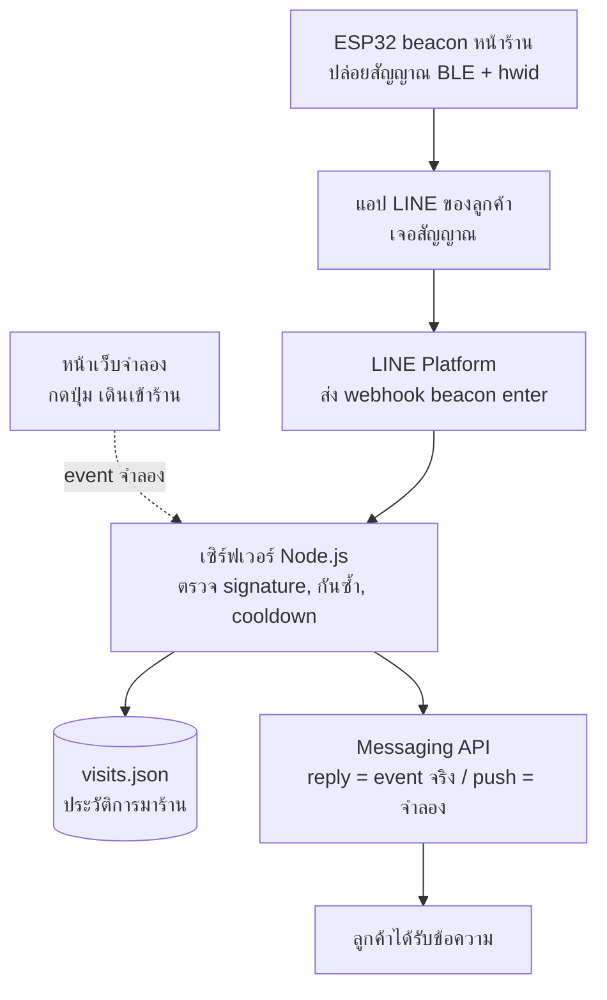

# Beacon Brew: LINE Beacon สำหรับร้านกาแฟ

ลูกค้าเดินเข้าร้าน แล้ว LINE ของร้านส่งข้อความต้อนรับ คูปอง และเมนูแนะนำให้อัตโนมัติ
ใช้ได้ทั้งกับบอร์ด ESP32 ที่ทำหน้าที่เป็น beacon และกับ**หน้าเว็บจำลอง**สำหรับทดสอบโดยไม่ต้องมีอุปกรณ์

> Beacon Brew เป็นร้านสมมติที่สร้างขึ้นเพื่อเป็นผลงาน

## ระบบทำงานยังไง



สิ่งที่หลายคนเข้าใจผิด: **beacon ไม่ได้จับสัญญาณมือถือ** มันแค่ปล่อยสัญญาณออกไป
แอป LINE ในมือถือเป็นฝ่ายเจอสัญญาณ แล้ว LINE ส่ง webhook มาที่เซิร์ฟเวอร์ของเรา

## ฟีเจอร์

- มาร้านครั้งแรก ได้คูปองส่วนลด 10%
- มาครั้งต่อไป ได้เมนูแนะนำตามช่วงเวลา (เช้า, บ่าย, เย็น ตามเวลาไทย) พร้อมบอกว่าอีกกี่ครั้งได้ฟรี
- มาครบทุก 5 ครั้ง ได้เครื่องดื่มฟรี
- beacon หลายจุด (ประตู, เคาน์เตอร์) ส่งข้อความต่างกัน
- **กันข้อความซ้ำ**: คนเดิมที่ beacon เดิมได้ข้อความไม่เกิน 1 ครั้งใน 24 ชั่วโมง
- ข้อความต้อนรับตอนแอดเพื่อน บอกวิธีเปิด Bluetooth และ LINE Beacon
- หน้าเว็บจำลองพร้อมหน้าจอแชทตัวอย่าง และแสดง JSON ที่ส่งเข้าเซิร์ฟเวอร์

## เริ่มใช้งาน

### 1. เตรียม LINE

1. สร้าง LINE Official Account ที่ [manager.line.biz](https://manager.line.biz)
2. ตั้งค่า > Messaging API > เปิดใช้ Messaging API (สร้าง Provider)
3. ตั้งค่าการตอบกลับ: ปิดข้อความตอบกลับอัตโนมัติ, ปิดข้อความทักทาย, ปิดเวลาตอบข้อความ
4. ใน [LINE Developers Console](https://developers.line.biz/console/) จดค่า Channel secret, Channel access token และ Your user ID

### 2. ติดตั้งและรัน

```bash
npm install
cp .env.example .env   # แล้วกรอกค่าจากข้อ 1
npm start
```

เปิด http://localhost:3000 จะเจอหน้าเว็บจำลอง

### 3. เปิดให้ LINE ส่ง webhook เข้ามาได้

LINE ต้องเรียกเซิร์ฟเวอร์ผ่าน HTTPS จากอินเทอร์เน็ต ระหว่างพัฒนาใช้ tunnel ได้ เช่น

```bash
npx cloudflared tunnel --url http://localhost:3000
# หรือ ngrok http 3000
```

นำ URL ที่ได้ไปใส่ใน LINE Developers Console > Messaging API > Webhook URL เป็น `https://<url>/webhook`
กด Verify แล้วเปิด Use webhook

### 4. แอดร้านเป็นเพื่อน

สแกน QR code ในแท็บ Messaging API ด้วย LINE ในมือถือ

## วิธีทดสอบ 3 แบบ

### แบบที่ 1: หน้าเว็บจำลอง (ไม่ต้องมีอุปกรณ์)

เปิด http://localhost:3000 แล้วกด "เดินเข้าร้าน" ข้อความจะเด้งเข้า LINE ของคุณ (บัญชีใน `LINE_DEMO_USER_ID`)

event จำลองไม่มี `replyToken` ระบบจึงส่งแบบ push ซึ่งนับโควตาข้อความของแพ็กเกจ LINE OA
ส่วน event จริงจาก LINE ตอบแบบ reply ไม่นับโควตา

### แบบที่ 2: มือถือ Android เป็น beacon (แอป nRF Connect)

1. ขอ LINE Simple Beacon Hardware ID จากหน้าลงทะเบียน beacon ของ LINE Official Account Manager
   ([วิธีดูในเอกสาร LINE](https://developers.line.biz/en/docs/messaging-api/using-beacons/))
2. ใส่ hwid ที่ได้ใน `config/beacons.json` แทน `0123456789`
3. ให้โปรแกรมคำนวณค่าที่ต้องกรอกในแอป

   ```bash
   npm run beacon:packet -- <hwid ของคุณ>
   ```

4. ใน nRF Connect ไปที่ ADVERTISER > สร้าง packet ตามค่าที่โปรแกรมพิมพ์ออกมา แล้วเปิดปล่อยสัญญาณ
5. ใช้มือถืออีกเครื่องที่แอดร้านไว้ เปิด Bluetooth และเปิด LINE Beacon ใน ตั้งค่า > ความเป็นส่วนตัว แล้วเดินเข้าใกล้

### แบบที่ 3: บอร์ด ESP32

1. เปิด `esp32/line_simple_beacon/line_simple_beacon.ino` ใน Arduino IDE
2. ใส่ hwid ในตัวแปร `HWID`
3. ติดตั้งบอร์ด esp32 (by Espressif) แล้วอัปโหลด

โค้ดตั้งกำลังส่งสัญญาณต่ำ (`ESP_PWR_LVL_N12`) ให้สัญญาณครอบคลุมแค่ในร้าน ไม่ล้นไปถึงคนเดินผ่าน

## การตัดสินใจในการออกแบบ

**ทำไมต้องมี cooldown**
สัญญาณ Bluetooth ขาด ๆ หาย ๆ โดยธรรมชาติ ยิ่งยืนอยู่ขอบระยะ มือถือจะเจอสลับกับหลุด
LINE จึงส่ง `enter` มาซ้ำเรื่อย ๆ เวอร์ชันแรกของโปรเจกต์นี้ส่งข้อความรัวจนผู้ใช้รำคาญ
เราห้ามสัญญาณหรือ LINE ไม่ได้ แต่คุมเซิร์ฟเวอร์ได้ จึงกรองที่เซิร์ฟเวอร์

**ทำไมจด "ลูกค้า + beacon" ไม่จดแค่ลูกค้า**
ถ้าจดแค่ลูกค้า คนที่ได้ข้อความจากประตูแล้วจะไม่ได้ข้อความที่เคาน์เตอร์เลย

**ทำไมจดก่อนส่ง ไม่ใช่ส่งก่อนจด**
event ที่มาติดกันในเสี้ยววินาทีจะได้ไม่หลุดผ่านไปได้ทั้งคู่
ข้อเสียคือถ้าส่งไม่สำเร็จ ลูกค้าจะพลาดข้อความรอบนั้น ซึ่งดีกว่าโดนส่งซ้ำ

**ทำไมตอบเฉพาะ `enter`**
LINE ยกเลิก event `leave` ไปตั้งแต่ปลายปี 2020 ระบบจึงรู้แค่ตอนลูกค้าเข้ามา ไม่รู้ว่าออกไปตอนไหน

**ทำไมตอบ 200 ให้ LINE ก่อนแล้วค่อยประมวลผล**
ถ้าเซิร์ฟเวอร์ตอบช้า LINE อาจส่ง event เดิมมาซ้ำ ระบบยังจำ `webhookEventId` ที่ทำไปแล้วไว้ กันซ้ำอีกชั้น

**ทำไมรับเฉพาะ hwid ที่ลงทะเบียนไว้**
LINE Simple Beacon ไม่มีกลไกกันการปลอม ใครรู้ hwid ก็ปล่อยสัญญาณเลียนแบบได้
ระบบจึงไม่ให้รางวัลที่มีมูลค่าสูงจาก beacon อย่างเดียว

## ข้อจำกัด

- ลูกค้าต้องเปิด Bluetooth, เปิด LINE Beacon ในแอป และแอดร้านเป็นเพื่อนก่อน
- beacon รู้แค่ว่ามือถืออยู่ในระยะ ไม่รู้ทิศทาง คนเดินผ่านหน้าร้านก็นับเป็น `enter` ได้
- ประวัติการมาร้านเก็บในไฟล์ JSON เหมาะกับเดโม ระบบจริงควรใช้ฐานข้อมูล
- ข้อความแบบ push (ใช้ตอนจำลอง) นับโควตาของแพ็กเกจ LINE OA

## โครงสร้างโปรเจกต์

```
src/
  server.js           เซิร์ฟเวอร์ Express: webhook + API ของหน้าเว็บจำลอง
  eventHandler.js     ตัดสินใจว่าจะส่งอะไร (cooldown, กันซ้ำ, กรอง beacon)
  cooldownStore.js    เก็บเวลาที่ส่งล่าสุดและจำนวนครั้งที่มาร้าน
  messages.js         ข้อความทั้งหมดของร้าน
  simulator.js        สร้าง beacon event จำลอง
  lineSimpleBeacon.js สร้างข้อมูลสัญญาณตามสเปก LINE Simple Beacon
  config.js           อ่านค่าจาก .env และ config/beacons.json
public/index.html     หน้าเว็บจำลอง
config/beacons.json   รายชื่อ beacon ของร้าน
esp32/                โค้ด Arduino สำหรับ ESP32
tools/beacon-packet.js คำนวณค่าสำหรับแอป nRF Connect
tests/                เทสต์ (ไม่ต้องต่อ LINE)
```

## เทสต์

```bash
npm test
```

ครอบคลุม cooldown, การนับครั้งที่มาร้าน, beacon หลายจุด, การกรอง beacon ที่ไม่รู้จัก,
event ซ้ำจาก LINE และตรวจว่าข้อมูลสัญญาณตรงกับตัวอย่างในสเปก LINE Simple Beacon

## ต่อยอด

ระบบเดียวกันนี้เปลี่ยนเป็นระบบเช็กชื่อเข้างานได้ โดยเปลี่ยนข้อความเป็นการบันทึกเวลา
และใช้ cooldown แบบ "บันทึกครั้งแรกของวัน"

## อ้างอิง

- [Use beacons with LINE](https://developers.line.biz/en/docs/messaging-api/using-beacons/)
- [LINE Simple Beacon specification](https://github.com/line/line-simple-beacon/blob/master/README.en.md)
- [Messaging API: beacon event](https://developers.line.biz/en/reference/messaging-api/#beacon-event)
